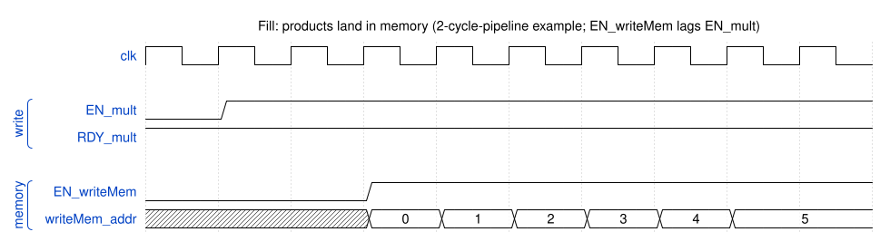
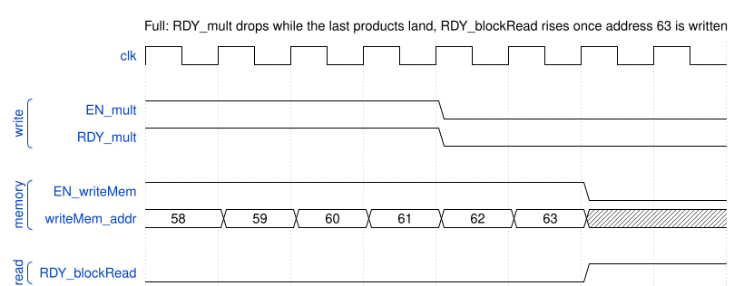
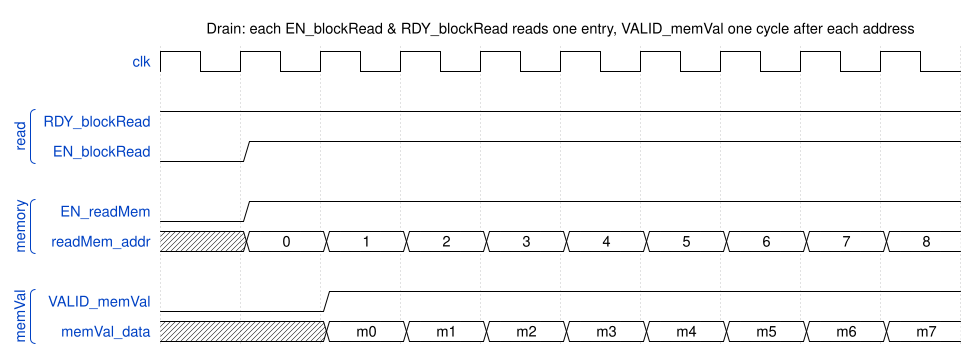
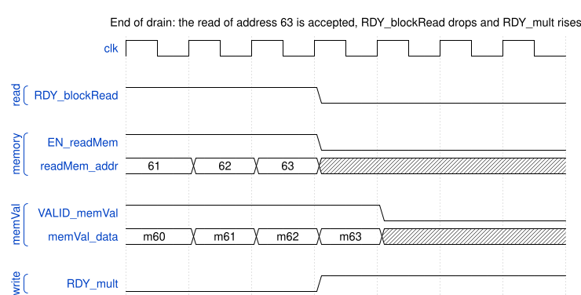

# mkMultBuff Design Specification

Pipelined signed 16 × 16 multiplier with a 64-entry fill/drain buffer

## 1. Scope

This document specifies `mkMultBuff`, a pipelined multiplier for 16-bit two's-complement operands. Its 32-bit products are stored in an external 64-entry memory and returned to a consumer in the order in which they were produced. Two implementations of the same interface are required, one closing timing at 400 MHz and one at 800 MHz.

## 2. Conventions

All registers are clocked on the rising edge of `clk`, and every cycle-level statement refers to signal values sampled at a rising edge. Requirements use "shall" and carry an identifier for traceability.

| Term | Definition |
|---|---|
| Accepted operand pair | Operands present in a cycle in which `EN_mult` = 1 and `RDY_mult` = 1 |
| Accepted read | A read request in a cycle in which `EN_blockRead` = 1 and `RDY_blockRead` = 1 |
| Fill phase | The interval from reset, or from the end of a drain phase, to the write of the 64th product |
| Drain phase | The interval from the assertion of `RDY_blockRead` to the acceptance of the 64th read |
| Latency | The number of cycles from the acceptance of an operand pair to the write of its product |

## 3. Interface

The port list is fixed and defined in `starter/rtl/mkMultBuff.sv`, with N = 32.

| Port | Direction | Width | Description |
|---|---|---|---|
| `clk` | input | 1 | Clock |
| `RST_N` | input | 1 | Synchronous reset, active low |
| `EN_mult` | input | 1 | The producer presents a valid operand pair |
| `mult_input0`, `mult_input1` | input | 16 | Operands, two's complement |
| `RDY_mult` | output | 1 | The block can accept an operand pair |
| `EN_blockRead` | input | 1 | The consumer requests a product |
| `RDY_blockRead` | output | 1 | The block can accept a read |
| `VALID_memVal` | output | 1 | `memVal_data` carries a product |
| `memVal_data` | output | N | Product returned to the consumer |
| `EN_writeMem` | output | 1 | Memory write enable |
| `writeMem_addr` | output | 6 | Memory write address |
| `writeMem_val` | output | N | Memory write data |
| `EN_readMem` | output | 1 | Memory read enable |
| `readMem_addr` | output | 6 | Memory read address |
| `readMem_val` | input | N | Memory read data |

The memory, `starter/rtl/memory_wrapper_2port.sv`, is a 64 × N two-port array instantiated in the testbench. It is not part of `mkMultBuff` and is excluded from synthesis. A write stores `writeMem_val` at a rising edge at which `EN_writeMem` = 1. A read registers the addressed word at a rising edge at which `EN_readMem` = 1, so `readMem_val` is valid in the following cycle.

## 4. Functional requirements

### 4.1 Datapath

| ID | Requirement |
|---|---|
| F1 | Each accepted operand pair shall produce exactly one memory write, whose data is the 32-bit two's-complement product of `mult_input0` and `mult_input1`. |
| F2 | Products shall be written in acceptance order to consecutive addresses, starting at address 0 in each fill phase. |
| F3 | The multiplier shall be fully pipelined and sustain a throughput of one operand pair per cycle. |
| F4 | The latency is implementation-defined. `EN_writeMem` shall be asserted only in cycles in which `writeMem_addr` and `writeMem_val` carry a valid address and product. |

### 4.2 Fill

| ID | Requirement |
|---|---|
| F5 | `RDY_mult` shall be 1 if and only if no drain phase is in progress and fewer than 64 operand pairs have been accepted in the current fill phase. Operand pairs in flight therefore count against the capacity of the memory. `EN_mult` shall have no effect while `RDY_mult` is 0. |

### 4.3 Transition to drain

| ID | Requirement |
|---|---|
| F6 | `RDY_blockRead` shall be asserted in the cycle following the write to address 63 and shall remain asserted until the 64th read is accepted. |

### 4.4 Drain

| ID | Requirement |
|---|---|
| F7 | In each cycle in which a read is accepted, `EN_readMem` shall be 1 and `readMem_addr` shall hold the next sequential address, starting at 0. |
| F8 | `VALID_memVal` shall be 1 in, and only in, the cycle following each accepted read. In that cycle `memVal_data` shall equal `readMem_val`, which shall not be registered again inside `mkMultBuff`. |
| F9 | `EN_blockRead` shall have no effect while `RDY_blockRead` is 0. |
| F10 | In the cycle following the accepted read of address 63, `RDY_blockRead` shall be 0 and `RDY_mult` shall be 1. |

### 4.5 Flow control and invariants

| ID | Requirement |
|---|---|
| F11 | The block shall operate correctly for any sequence of `EN_mult` and `EN_blockRead`. Deasserting either signal stalls the corresponding transfer without loss or duplication of data. |
| F12 | `RDY_mult` and `RDY_blockRead` shall never be 1 in the same cycle. |
| F13 | `EN_writeMem` and `EN_readMem` shall never be 1 in the same cycle. |

### 4.6 Reset

| ID | Requirement |
|---|---|
| F14 | Every register shall have a synchronous, active-low reset driven by `RST_N`. |
| F15 | In the cycle following a rising edge at which `RST_N` = 0, no product shall be in flight or stored and `RDY_mult` shall be 1. `EN_writeMem`, `writeMem_addr`, `RDY_blockRead`, `EN_readMem` and `VALID_memVal` shall be 0. |

Figures 1 to 4 illustrate the phases of operation for an implementation with a latency of two cycles.









## 5. Implementation targets

| Parameter | 400 MHz implementation | 800 MHz implementation |
|---|---|---|
| Source directory | `submission/rtl_400/` | `submission/rtl_800/` |
| Clock period | 2.5 ns | 1.25 ns |
| Pipeline stages | 2 minimum | Implementation-defined |
| Worst slack, required | ≥ 0 ps | ≥ 0 ps |
| Worst slack, target | ≥ 125 ps (5 % of period) | ≥ 62 ps (5 % of period) |
| Cell area | < 6000 µm² | < 12000 µm² |
| Power | Minimized, reported in µW from simulation activity | Minimized, reported in µW from simulation activity |

Each implementation shall have `mkMultBuff` as its top module and shall compile from the complete set of `.sv` files in its source directory, read in any order. `` `include`` directives shall not be used. The targets apply to the results of the open-source flow in Section 7. The slack target leaves margin for physical implementation. Among implementations that meet timing and area, lower area and lower power are preferred.

## 6. Technology and constraints

The open-source flow targets the Nangate45 Open Cell Library, which is built on the FreePDK45 process, at its slowest available corner. The install script written under Section 7 shall obtain the library from a public source, which the report shall identify together with the corner used. The library is not stored in this repository.

For comparison with designs built on the GPDK045 library, the sign-off service of Section 8.3 synthesizes the submitted RTL with GPDK045 and simulates the resulting netlists. Its results are reported alongside those of the open-source flow, not in place of them.

| Constraint | Value |
|---|---|
| Clock period | 2.5 ns or 1.25 ns |
| Input delay, all inputs except `clk` | 0 ns |
| Output delay, all outputs | 0 ns |
| Input drive | Output of the smallest D flip-flop in the library |
| Input transition | One eighth of the clock period |
| Output load | Four times the capacitance of one input of the library's X4 two-input NAND (`NAND2_X4` in Nangate45) |

Synthesis may target a shorter internal clock period and may retime registers. All reported figures are evaluated at the target period.

## 7. Tool flow

The flow shall use open-source tools only and shall be reproducible on a clean Linux host through an install script in the repository. Each step is invoked from the repository root as `make <step> RUN=<400|800>`.

| Step | Function | Output |
|---|---|---|
| `synth` | Synthesis of `submission/rtl_<RUN>/` to the target library | Netlist and SDF in `submission/outputs/`; reports in `submission/syn_reports/` |
| `check` | RTL simulation with the RTL checker | Simulation log ending in `ALL PASS` |
| `sim` | Gate-level simulation of the netlist with the RTL checker, without back-annotation | Value change dump (VCD) |
| `timing` | Gate-level simulation with SDF back-annotation and the gate-level checker | Simulation log reporting `ALL PASS` or `TIMING FAIL` |
| `power` | Activity-based power analysis from the VCD | Power report |

Open-source code and optimization techniques may be used where their licenses permit, with each source cited in the report. Complete implementations of this specification from other sources shall not be used.

## 8. Verification requirements

The harnesses in `starter/tb/` instantiate the design and the memory and generate the clock.

### 8.1 RTL checker

The RTL checker, `submission/testbench/rtl_checker.sv` with top module `mkMultBuff_tb`, shall

- run at least eight complete fill and drain phases
- drive operands from a random source, in addition to the directed pairs (−32768, −32768), (−1, 1), (0, 32767), (32767, 32767) and (−1, −1)
- deassert `EN_mult` within a fill phase and `EN_blockRead` within a drain phase
- compare every product returned on `memVal_data` with an independent reference model
- check every observable requirement of Section 4
- print `ALL PASS` if and only if no check has failed

The stimulus shall also contain one fill phase with `EN_mult` held at 1 for 64 consecutive cycles and one drain phase with `EN_blockRead` held at 1 for 64 consecutive cycles. These windows are used for power analysis.

### 8.2 Gate-level checkers

The gate-level checkers, `submission/testbench/sdf_checker_400.sv` and `sdf_checker_800.sv` with top modules `mkMultBuff_sdf_checker_400` and `mkMultBuff_sdf_checker_800`, simulate the synthesized netlist with SDF back-annotation at fixed clock periods of 2.5 ns and 1.25 ns. The SDF file is supplied as `+sdf_file=<path>`. Each checker shall

- drive inputs after the rising edge and sample outputs at the falling edge
- apply random operands over multiple fill and drain phases
- report `TIMING FAIL` for any unknown (X) or incorrect value on `memVal_data` while `VALID_memVal` is 1
- print `ALL PASS` if and only if no failure has occurred

Each checker shall pass a netlist that meets timing and fail a netlist that violates it. Both outcomes shall be demonstrated and their logs retained. Where the available cell models or simulator do not turn a timing violation into an unknown value, the checker shall detect the violation through the resulting incorrect values, and the report shall describe the limitation.

### 8.3 Sign-off service

Pushing a branch named `check/<label>` submits the RTL in `submission/rtl_400/` and `submission/rtl_800/` to an independent sign-off service. The latest commit on the branch is checked after each push. The service synthesizes each implementation with GPDK045 under the constraints of Section 6 and simulates the resulting netlists with SDF back-annotation against an independent testbench. Its scorecard is published on branch `check-results`.

## 9. Deliverables

```
submission/
  rtl_400/       400 MHz implementation
  rtl_800/       800 MHz implementation
  scripts/       synthesis and flow scripts
  testbench/     rtl_checker.sv, sdf_checker_400.sv, sdf_checker_800.sv
  outputs/       synthesis outputs
  syn_reports/   synthesis and power reports
  pdf_report/    report.pdf
```

The report shall contain

1. area and power at both frequencies, as a synthesis estimate and from activity-based analysis
2. the pipeline depth and the critical path at each frequency
3. the changes made to meet 800 MHz
4. a state diagram of every state machine and a datapath diagram showing each pipeline stage and its registers
5. a description of each checker, comparing RTL and gate-level waveforms and identifying effects that appear only at gate level, such as clock-to-output delay and glitches on `RDY_mult`
6. the optimization techniques applied and their measured effect
7. a description of the tool flow and of any departure from the constraints of Section 6
8. a comparison of the open-source results with the GPDK045 sign-off results
9. the external sources used, with citations
10. the source listing, as an appendix

The report is generated by the implementing agent and shall be identified as AI-generated on its first page.
