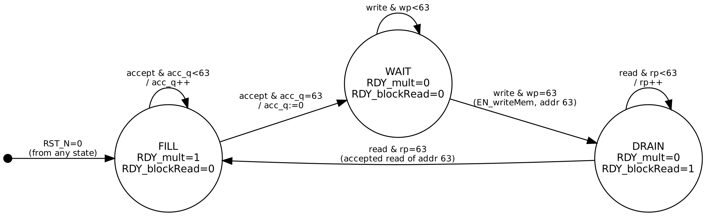
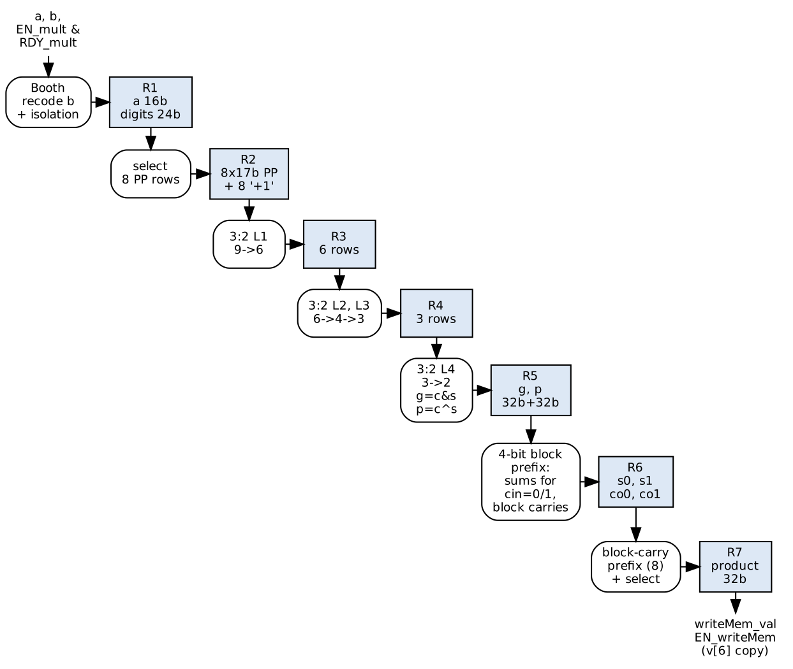
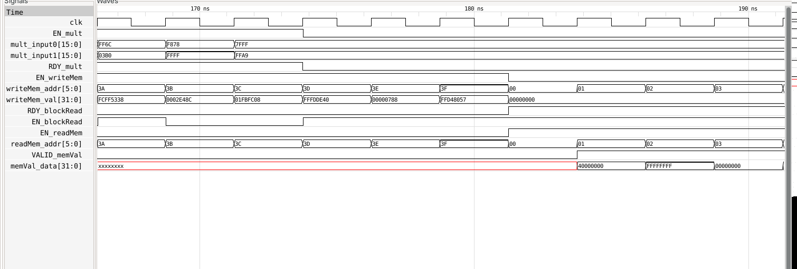

\begin{center}\fbox{\parbox{0.92\textwidth}{\textbf{AI-generated report.} This report, the RTL, the testbenches and the flow scripts it describes were produced by an AI agent, Claude Opus 5.5 (Anthropic), working autonomously in a Claude Code session with subagents. The author of record is that model. Every number in the report comes from a tool log kept in the repository under \texttt{submission/syn\_reports/}, and the chronological record of decisions is \texttt{notes/WORKLOG.md}.}}\end{center}

# Results at a glance

The block accepts one pair of 16-bit two's-complement operands per cycle, writes each 32-bit product into an external 64-word memory in acceptance order, and once the memory is full hands the 64 products back to a consumer in the same order. Two implementations of the same interface were built, one for a 2.5 ns clock and one for a 1.25 ns clock, and both were taken through synthesis, static timing, gate-level simulation with and without SDF back-annotation, and activity-based power analysis. The table collects the figures that SPEC.md Section 5 asks for. Slack, area and power are evaluated at the target period under the constraints of Section 6 at the Nangate45 slow corner (process "slow", 0.95 V, 125 °C).

| Quantity | 400 MHz (2.5 ns) | 800 MHz (1.25 ns) | Target |
|------------------------------------|---------:|---------:|----------------|
| Register ranks (latency, cycles) | 3 | 7 | ≥ 2 at 400 MHz |
| Flip-flops | 166 | 577 | |
| Worst setup slack | +0.152 ns | +0.075 ns | ≥ 0, target ≥ 5 % of period |
| Worst hold slack | +0.053 ns | +0.041 ns | ≥ 0 |
| Cell area | 2386.6 µm² | 4755.0 µm² | < 6000 / < 12000 µm² |
| Power, synthesis estimate (vectorless) | 652.5 µW | 2727.6 µW | minimise |
| Power, activity-based, whole checker run | 642.8 µW | 3073.1 µW | minimise |
| Power, 64-cycle fill window | 1480.1 µW | 5209.5 µW | |
| Power, 64-cycle drain window | 430.4 µW | 2535.6 µW | |
| `make check` (RTL) | ALL PASS | ALL PASS | |
| `make sim` (gate level, zero delay) | ALL PASS | ALL PASS | |
| `make timing` (gate level, SDF) | ALL PASS | ALL PASS | |
| Netlist violating timing, gate-level checker | TIMING FAIL | TIMING FAIL | must fail |
| F14 formal check (every flip-flop reset by `RST_N`) | 166 of 166 | 577 of 577 | all |
| Mutants of the RTL killed by the RTL checker | 11 of 11 | 13 of 13 | |
| GPDK045 sign-off service | see Section 9 | see Section 9 | |

Both implementations meet the required and the target slack, and both are well inside their area limits. The 800 MHz design is the smallest and lowest-power of three candidate microarchitectures that were evaluated in parallel, two of which met timing.

# The design

## What the block has to do

The difficulty of this block is less the multiplier than the bookkeeping around it. Suppose the producer offers operand pairs on every cycle and the multiplier takes three cycles to produce a product. When the 64th pair is accepted, products 62, 63 and 64 are still inside the pipeline and have not reached the memory. SPEC requirement F5 says that `RDY_mult` must already be 0 at that moment, because pairs in flight count against the capacity. Requirement F6 says that `RDY_blockRead` may rise only in the cycle after the write to address 63, which happens three cycles later. So the block passes through a short third state in which it accepts neither operands nor reads, and the length of that state equals the pipeline latency. Writing the control around this observation gives a state machine with three states and two counters, whatever the latency.

## The state machine

The control is the same in both implementations and is shown in Figure 1. The state is encoded directly in the two registered ready flags, so the outputs `RDY_mult` and `RDY_blockRead` come straight from flip-flops and cannot glitch. In FILL a 6-bit counter `acc_q` counts accepted pairs and the move to WAIT happens on the 64th acceptance. In WAIT the block only finishes the products already in the pipeline. The write pointer reaching 63 with a write in progress moves it to DRAIN, which satisfies F6. In DRAIN each accepted read drives `EN_readMem` and the current read pointer combinationally (F7), and the accepted read of address 63 returns the machine to FILL, so `RDY_mult` is 1 in the following cycle (F10). Every pointer and counter wraps naturally from 63 to 0, so each fill starts at address 0 without extra logic (F2). A synchronous reset from any state returns to FILL with every pipeline valid bit cleared, which is the content of F15.

{width=100%}

Alongside the state machine, a shift register of valid bits, one per register rank, travels with the data. Its last bit is `EN_writeMem`, so a write can happen only in a cycle that carries a real product (F4). `VALID_memVal` is the accepted-read signal delayed by one cycle, and `memVal_data` is a wire from `readMem_val`, which F8 forbids registering again.

## The multiplier

Both implementations use the same arithmetic, a radix-4 modified Booth multiplier [10, 13]. The multiplier operand `b` is recoded into eight digits in {−2, −1, 0, 1, 2}, each represented by three bits (`one`, `two`, `neg`). Each digit selects 0, `a` or `2a`, inverts it when the digit is negative, and so produces one 17-bit partial-product row. The "+1" that completes each two's-complement negation is placed in the empty low bit of the next row, and the sign extension of every row is replaced by inverting its sign bit and adding one constant, 0xAAAB0000. This leaves nine rows of known width. Four levels of 3:2 carry-save compression reduce them to two (9 → 6 → 4 → 3 → 2), in the style of a Wallace tree [11], and a fast carry-propagate adder produces the product. Each register rank that cuts this datapath is a parameter of the module `mult_pipe`, which made it possible to measure many cut positions quickly.

Two choices are shared by both designs and matter for area and power. The multiplier operand is Booth-recoded before the first register, so that rank holds 24 digit bits instead of 16 operand bits, and the recoding logic and its fan-out leave the critical multiply stage. And the first register rank loads zeros whenever no pair is accepted. Section 7 shows what this operand isolation saves.

## The 400 MHz datapath

At 2.5 ns the multiplier is split into two stages by three register ranks (Figure 2). The first rank holds the operand `a` and the Booth digits of `b`. The second holds the four carry-save rows left after two compression levels. The third holds the product after the last two levels and a 32-bit Kogge-Stone adder [12], and drives `writeMem_val` directly. The latency is therefore 3, one more than the minimum of 2 that SPEC allows. A latency of 2 would require the whole multiply in one stage, and at this corner a whole 16 × 16 multiply needs about 4.4 ns of logic (Section 7).

{width=62%}

## The 800 MHz datapath

At 1.25 ns a flip-flop's clock-to-output delay (0.35 to 0.46 ns at this corner) and setup time (about 0.06 ns) leave roughly 0.75 ns of logic per stage, which is about two XOR delays. The multiplier therefore spreads over seven register ranks (Figure 3). The ranks hold the operands and Booth digits, the selected partial products, the six rows after level 1, the three rows after levels 2 and 3, the generate and propagate bits of the final two rows, the block sums of a two-stage carry-select adder, and the product. Level 3 is a single 3:2 compressor acting on three of four rows, which is why it shares a stage with level 2.

{width=78%}

The control logic of the 800 MHz design also differs in three details, all made for timing. It has separate write and read pointers, and it keeps a second, port-only copy of each ready flag, of each address and of `EN_writeMem`. Section 4 explains why each was needed.

# Critical paths

At 400 MHz the worst path starts at a multiplicand bit of the first rank (`a17[8]`, fan-out 16, clock to Q 0.66 ns) and runs through the Booth selection gate (AOI22), the negation XNOR, two carry-save levels (four XOR/XNOR gates) and the synchronous-reset AND into a carry-save register of rank 2. It arrives at 2.300 ns against a required time of 2.452 ns, giving a slack of +0.152 ns. The final adder stage is nearly as long, which is what one expects when the cut balances the two halves of the multiplier.

At 800 MHz the worst path starts at a level-1 carry-save register (`l1q[75]`, clock to Q 0.41 ns) and runs through levels 2 and 3 (XOR, XNOR, XOR) and two carry gates (OAI21, AOI21) into rank 4. It arrives at 1.113 ns against 1.187 ns, giving +0.075 ns. After the last round of optimisation the slack is spread evenly. The adder stages and the selection stage all finish within about 0.1 ns of the worst path, so no single fix would raise the slack much further.

Both full path reports, including slews, capacitances and fan-outs, are in `submission/syn_reports/<RUN>/sta.rpt`.

# Changes made to meet 800 MHz

The first attempt at 1.25 ns reused the 400 MHz structure with more register ranks and failed by more than a nanosecond. Each step below was found by reading the worst path that OpenSTA reported and removing its cause. The steps are listed in the order they were made, so that the effect of each can be read from the table.

| Step | Change | WNS (ns) | Area (µm²) |
|--|----------------------------------------------------------|------:|------:|
| 1 | Carry-save registers after levels 2 and 4, adder split into two 16-bit halves | −1.136 | 3655 |
| 2 | Buffering of the `RST_N` net enabled (throw-away placement for the Resizer) | −0.729 | 4182 |
| 3 | Register after partial-product selection, all four levels registered, two-stage carry-select adder | −0.610 | 5413 |
| 4 | Slow stacked cells kept out of ABC's mapping (`dont_use` Liberty copy) | −0.440 | 5573 |
| 5 | Carry-select blocks rewritten with an explicit Kogge-Stone prefix, 4-bit blocks | −0.159 | 5853 |
| 6 | Separate write and read pointers | −0.090 | 5965 |
| 7 | Port-only copies of the ready flags, addresses and `EN_writeMem` | −0.014 | 5786 |
| 8 | Block carries of the carry-select adder resolved by a prefix instead of a ripple | −0.034 | 5933 |
| 9 | MUX2 also kept out of the mapping | +0.051 | 5893 |
| 10 | Generate/propagate of the final rows computed before rank 5 | +0.136 | 5824 |
| 11 | ABC told that its outputs are flip-flop inputs (1 fF), not ports (23.5 fF) | +0.150 | 5211 |
| 12 | Levels 2 and 3 merged into one stage (final design) | +0.075 | 4755 |

A few of these steps deserve explanation because the cause was not obvious from the RTL. The reset net was the first wall (step 2). Every register has a synchronous reset, so `RST_N` fans out to several hundred gates, and the constraint models its driver as a single DFF_X1. Without a buffer tree that net alone took 1.4 to 2.6 ns. OpenROAD's Resizer can build the tree, but only if the cells have locations, so the flow places the netlist once purely to let the Resizer insert buffers. Timing is still computed with the library wire-load model, the same view as sign-off.

Step 5 corrected a synthesis artefact. Yosys builds the carry-in-1 sum of a carry-select block, `x + y + 1`, as two adders in series. Writing the block as one generate/propagate prefix that delivers both sums at once removed about 0.45 ns.

Steps 6 and 7 deal with the output load. SPEC loads every output with four NAND2_X4 inputs (23.5 fF), and a flip-flop driving that load has a clock-to-output delay of 0.57 to 0.66 ns instead of 0.35 ns. When the same flip-flop also feeds the next-state logic, the slow output becomes the start of an internal critical path. The fix is to keep two copies of each such register, one for the port and one for the logic. Synthesis merges registers with identical inputs, and a `keep` attribute did not prevent it. So the port copies are stored inverted, which makes their inputs structurally different, and are inverted again at the port.

Step 11 was a constraint seen by ABC rather than by the design. The flow gave ABC the SPEC output load for all of its outputs, but for ABC almost every output is a flip-flop D pin. ABC was therefore buffering every register input as if it drove a port. Correcting the load removed about 600 µm² and recovered slack. That slack was then spent in step 12, merging two compression levels into one stage, which removed a whole register rank of 96 bits and about 450 µm².

## Candidate microarchitectures

Three candidates for 800 MHz were evaluated in parallel by separate subagents under the same flow and constraints. The comparison is summarised below.

| Candidate | Latency | Flops | WNS (ns) | Area (µm²) | Power run / fill / drain (µW) |
|----------------------------------|---:|----:|----------:|------:|--------------:|
| (A) Booth radix-4, carry-save rows, carry-select adder, hand cut (chosen) | 7 | 577 | +0.075 | 4755 | 3073 / 5210 / 2536 |
| (B) Behavioural `*` with extra ranks and ABC retiming | 8 | about 600 | −0.202 (best of 8 runs) | 5819–6126 | 3520 / 6824 / 2660 (R = 7) |
| (C) Baugh-Wooley [14] partial products, generated Dadda tree [11], three-stage adder | 8 | 616 | +0.150 | 5278 | 3279 / 5725 / 2702 |

Candidate (B) was rejected for two reasons. It does not meet timing, because ABC retimes with unit gate delays and stops improving near −0.2 ns. And it breaks F14, because the retimed registers lose their synchronous reset (319 of 432 flip-flops in one run) unless a non-standard strip-and-re-add step is inserted. Its RTL is also a single-cycle multiplier followed by delay registers, which the GPDK045 sign-off flow would not retime.

Candidates (A) and (C) both meet the 62 ps target. (C) has twice the slack, but (A) is 10 % smaller and draws 6 to 9 % less power in every measured case. SPEC ranks area and power once timing and area are met, so (A) was kept.

# Area and power

Area is the sum of the Liberty cell areas of the final netlist (`sta.rpt`, "cell area"). Flip-flops are 32 % of the area at 400 MHz and 55 % at 800 MHz. Nangate45 has no flip-flop with a synchronous reset, so each register bit also carries one reset gate.

Two kinds of power figure are reported. The synthesis estimate is OpenSTA's vectorless `report_power`, which assumes an activity of 0.1 transitions per cycle on every input and propagates it through the logic. The activity-based figures use the value change dump of `make sim`, which runs the full RTL-checker stimulus on the netlist, read with OpenSTA's `read_vcd`. Besides the whole run, two 64-cycle windows are reported, one in which `EN_mult` is held at 1 so that 64 pairs enter back to back, and one in which `EN_blockRead` is held at 1 while the producer is idle.

| Power (µW) | 400 MHz internal | switching | leakage | total | 800 MHz total |
|--------------|------:|------:|------:|------:|------:|
| Synthesis estimate | 459.7 | 160.4 | 32.5 | 652.5 | 2727.6 |
| Whole run | 455.0 | 155.3 | 32.6 | 642.8 | 3073.1 |
| Fill window | 815.8 | 629.8 | 34.5 | 1480.1 | 5209.5 |
| Drain window | 372.6 | 25.8 | 32.0 | 430.4 | 2535.6 |

The two windows show where the power goes. During the fill window the multiplier switches on every cycle, and switching power, the energy of charging the logic and wires, is as large as the internal power. During the drain window the datapath is quiet because the operand register holds zeros, and switching power almost disappears. What remains, 372 µW of 430 µW at 400 MHz, is the internal power of the flip-flops, which toggle their clock pins on every cycle whether or not their data changes. The 800 MHz design has 3.5 times as many flip-flops running at twice the frequency, and its drain-window power is 5.9 times larger, close to the 7 times one would predict from those two factors alone. Clock gating would remove most of the drain power, but it was not used, because it adds latches and gated clocks that complicate the reset requirement and the sign-off flow.

The vectorless estimate is close to the measured whole-run power at 400 MHz (653 µW against 643 µW) and somewhat below it at 800 MHz (2728 µW against 3073 µW), where the long carry-save paths switch more than an activity of 0.1 suggests. The activity-based figures come from a zero-delay simulation, as SPEC Section 7 prescribes for `sim`, so they exclude glitch power. The gate-level waveforms of Section 6 show that glitches do occur on the wide datapath outputs, so the real power is somewhat higher.

# Verification

## The RTL checker

The RTL checker (`rtl_checker.sv`, top module `mkMultBuff_tb`) was written by a subagent from SPEC.md alone, without access to the RTL, so that it would not inherit the RTL's reading of the specification. At its core is a cycle-accurate reference model of the ready/valid behaviour that depends only on the inputs and on the latency. The latency is learned from the first write and must then stay constant. Every cycle, the checker compares each output with the model and counts each comparison against the requirement it belongs to (F1 to F15, data, and X/Z). It drives inputs 0.1 ns after the rising edge and samples at the falling edge, which keeps it free of races in RTL, in zero-delay gate-level and in SDF simulation alike.

The stimulus runs 14 complete fill and drain phases, about 5900 cycles, with acceptance densities from 10 to 100 %. Operands are random, with the five directed pairs of Section 8.1 and further corner pairs inserted. While a ready signal is 0, `EN_mult` or `EN_blockRead` is driven to 1 with random data, to show that it has no effect (F5, F9). Reset is applied four times: at power-up, in the middle of a fill, with the pipeline full of products, and in the middle of a drain. One fill holds `EN_mult` at 1 for 64 cycles and one drain holds `EN_blockRead` at 1 for 64 cycles. These are the power windows, and the checker prints their start and end times. It prints `ALL PASS` only if every one of roughly 50 000 checks passed. Both RTL implementations and both netlists pass.

Two further pieces of evidence show that the checker is sensitive. A mutation test (`submission/scripts/mutate.sh`) makes one-line changes to the real RTL, for example dropping `RDY_mult` one pair early, starting the drain one write early, not resetting the valid pipeline, holding `EN_readMem` through the drain, or injecting a carry-in error into the adder. The checker kills all 11 mutants at 400 MHz and all 13 at 800 MHz (`mutation.log`). And a SAT-based check on the netlists (`make f14`, written by the retiming subagent) proves, for every flip-flop, that its D input is constant whenever `RST_N` = 0 with all other signals free. All 166 and all 577 flip-flops pass, which establishes F14, a requirement that simulation alone cannot show.

## The gate-level checkers

The gate-level checkers (`sdf_checker_400.sv`, `sdf_checker_800.sv`) simulate the netlist with SDF back-annotation at fixed periods of 2.5 ns and 1.25 ns. They drive inputs 20 ps after the rising edge and sample at the falling edge. They run six fill and drain phases, mostly back to back, with random and corner operands biased towards long carry chains. They report `TIMING FAIL` for any X or wrong value on `memVal_data` while `VALID_memVal` is 1, and also for missing products, unexpected valids or a phase that does not complete, so that a netlist cannot pass by producing nothing.

The simulator, Icarus Verilog 12, applies SDF path and interconnect delays but ignores the `$setuphold` timing checks of the cell models. A setup violation therefore never produces an X. Instead, the flip-flop captures the value its D input held at the clock edge, which is the previous, stale value. This was verified before the checkers were written, with a single DFF_X1 whose D changed 50 ps before the clock edge. The gate-level checkers therefore detect violations through the incorrect values that reach `memVal_data`, as SPEC 8.2 allows. The limitation is real, because a violation that happens to capture the correct value goes unnoticed, and a simulator that evaluates timing checks would catch it as X. The open-source simulator OSS CVC does evaluate them, but building it from source was not permitted in this session. Icarus reads the "typical" entry of each SDF delay triple, so the flow rewrites every triple to carry the maximum delay there, which makes the simulation pessimistic for setup.

SPEC asks that each checker pass a netlist that meets timing and fail one that violates it. Both outcomes were demonstrated (`make timing_fail`, logs in `syn_reports/<RUN>/timing_fail/`). At 400 MHz the failing netlist is a variant with the whole multiplier in one stage, synthesised with the same flow, whose slack is −1.469 ns. The checker reported 172 failures, the first being `memVal_data = 87fc0013` where `00000013` was expected (−1 × −19), a product whose upper bits were captured before they settled. At 800 MHz the failing netlist is the 400 MHz netlist run at 1.25 ns, with a slack of −1.091 ns. There the control path fails first, the drain never starts, and the checker reports TIMING FAIL for 64 accepted pairs and no returned products.

## RTL and gate-level waveforms

The figures below were produced headlessly with GTKWave under Xvfb from runs of the same gate-level checker on the RTL and on the SDF-annotated netlist, so the two waveforms show the same cycles. Figure 4 shows the transition from fill to drain at 400 MHz in the RTL. The last pairs enter, `RDY_mult` drops after the 64th acceptance, the last three products are written to addresses 3D to 3F, `RDY_blockRead` rises in the cycle after the write to 3F, and the reads begin.

{width=100%}

{width=100%}

{width=100%}

Figures 5 and 6 show the same three cycles in RTL and at gate level. In the RTL every output changes exactly at the clock edge. At gate level three effects appear that the RTL cannot show. First, every registered output changes some time after the edge. `writeMem_addr` settles about 0.45 ns after the edge and `RDY_blockRead` about 0.6 ns after it, because these flip-flops drive the 23.5 fF port load. This clock-to-output delay is why the checkers sample at the falling edge. Second, the 32-bit `writeMem_val` passes through a short intermediate value (shown as "000+") before settling, because its bits leave flip-flops with different loads and therefore different delays. The memory only stores the value at the next rising edge, so the glitch is harmless, but it costs switching power. Third, `EN_readMem` rises shortly after `EN_blockRead` changes, 20 ps after the edge, delayed by one AND gate, because it is the only control output that is combinational from an input, as F7 requires. `RDY_mult` is a flip-flop output in both designs, and in contrast to designs that decode it from a counter, it shows no glitch. Figure 7 shows the same window at 800 MHz, where the clock-to-output delays take up about half of each 1.25 ns cycle and the intermediate values on `writeMem_val` appear on every cycle of the fill.

{width=100%}

The remaining figures (start of fill and end of drain, RTL and gate level, at both frequencies) are in `submission/pdf_report/fig/`. In the end-of-drain figure, `RDY_blockRead` falls and `RDY_mult` rises in the cycle after the read of address 63, as F10 requires.

# Optimisation techniques and their measured effect

The table lists the techniques applied, with the measured effect of each. Each was measured by changing one thing and re-running the flow. Synthesis results move by up to ±0.2 ns when the netlist structure changes in ways that do not alter its function, so slack differences smaller than that are not significant.

| Technique | Where | Measured effect |
|---------------------------------------|----|------------------------------|
| Parallel-prefix final adder (Kogge-Stone map for Yosys `$lcu`) instead of ripple | both | single-stage multiply path 8.0 → 6.3 ns |
| OpenROAD Resizer: gate sizing and pin swapping | both | single-stage multiply −3.83 → −1.92 ns slack |
| Booth recoding before the first register | both | 400 MHz area 2871 → 2387 µm² at equal latency |
| Placement only to let the Resizer buffer `RST_N` | 800 | −1.24 → −0.73 ns |
| Liberty copy with slow stacked cells and MUX2 as `dont_use` for mapping | 800 | −0.61 → −0.44 ns, then −0.034 → +0.051 ns |
| Explicit prefix carry-select adder | 800 | −0.44 → −0.16 ns |
| Port-only register copies, separate pointers | 800 | −0.159 → −0.014 ns |
| Generate/propagate moved before the register | 800 | +0.051 → +0.136 ns |
| Correct load model for ABC's outputs | 800 | −612 µm², slack +0.014 ns |
| Merging compression levels 2 and 3 into one stage | 800 | −456 µm², −0.34 mW vectorless |
| Operand isolation (zeros loaded when idle) | 400 | whole-run power 1402 → 643 µW (−54 %), +49 µm² |

Operand isolation deserves a comment, because it costs almost nothing. The first register already needs one gate per bit for the synchronous reset, and the isolation adds only the accept signal to that gate's input. Without isolation, the random operands that the producer presents while the block is not ready flow into the multiplier and switch it on every cycle. The measurement used a variant of the 400 MHz design that loads the inputs every cycle (`syn_reports/400/experiments/`). Whole-run power more than doubled, from 643 µW to 1402 µW. The two windows hardly changed, because the producer is busy in the fill window and quiet in the drain window.

# Tool flow and departures from the constraints

The flow uses open-source tools only and is reproducible from `bash submission/scripts/install.sh` followed by `make <step> RUN=<400|800>`. The install script installs Icarus Verilog, GTKWave, Xvfb and LaTeX with apt. It pulls two Docker images pinned by digest: `openroad/orfs` for Yosys 0.68 and the OpenROAD Resizer, and `openroad/opensta` for OpenSTA 3.1.0. It also downloads the Nangate45 Liberty and Verilog files from a pinned commit of `mflowgen/freepdk-45nm` [2] and verifies their checksums. All tool versions are recorded in `submission/syn_reports/tool_versions.txt`. The steps are as follows.

| Step | Tools | What it does |
|-----|----------|---------------------------------------------|
| `synth` | Yosys + ABC, OpenROAD Resizer, OpenSTA | Reads every `.sv` file of the source directory and maps to Nangate45 with an ABC script adapted from OpenROAD-flow-scripts [5]. The Resizer then sizes and buffers the netlist, and OpenSTA reports timing, area and the vectorless power and writes the SDF |
| `check` | Icarus Verilog | RTL simulation with the RTL checker |
| `sim` | Icarus Verilog | zero-delay gate-level simulation with the Nangate cell models and the RTL checker, writing the VCD |
| `timing` | Icarus Verilog `-gspecify` | gate-level simulation with SDF back-annotation and the gate-level checker |
| `power` | OpenSTA `read_vcd` | activity-based power for the whole run and the two windows |
| `timing_fail`, `f14` | as above, Yosys SAT | failing-netlist demonstration, formal reset check |

The constraints of Section 6 are applied exactly as written in `submission/scripts/constraints.tcl`, with three interpretations and additions that should be stated. First, SPEC gives both a driving cell for the inputs (the output of DFF_X1) and an input transition of one eighth of the period. The two were combined by using DFF_X1/Q as the driving cell, with a transition of T/8 at the input of that driving cell. The clock was also given a transition of T/8. Second, OpenSTA was given the library's default wire-load model, `5K_hvratio_1_1`, so that net capacitance is not taken as zero before layout. Third, the output load is four times the A1 input capacitance of NAND2_X4 in the slow library, 23.54 fF.

The remaining departures concern how the tools were used, not the constraints, and all reported figures are evaluated at the target period with the constraints above.

- The "slowest available corner" is the `slow` operating condition (process 1.0, 0.95 V, 125 °C) of the public mirror. The original Nangate release also contains a low-temperature worst-case corner, which is not in any public mirror found.
- Inside synthesis, ABC sees a Liberty copy in which slow stacked cells are marked `dont_use`, and its own driver and load settings differ from SPEC (1 fF at the flip-flop D pins, for the reason given in Section 4).
- The Resizer places the netlist once to enable buffer insertion. The placement is discarded.
- The simulation copy of the netlist declares an unused `parameter N = 32`, because the starter harness instantiates `mkMultBuff #(.N(N))` and a flat netlist has no parameters.
- The SDF delay triples carry their maximum value in the typical position, because Icarus annotates the typical value.
- Activity-based power excludes glitch power (zero-delay VCD), and Icarus ignores timing checks (Section 6).

# Comparison with the GPDK045 sign-off service

SIGNOFF_SECTION

# Project metrics

The work took one Claude Code session, which began at 02:33 UTC and ended with the report at about WALLCLOCK_END UTC. In the session, the main agent built the toolchain, the 400 MHz design, candidate (A) and the flow, and wrote the report, while four subagents worked in parallel. One wrote the checkers, two evaluated candidates (B) and (C), and none ran more than two flows at once. Token usage was counted from the session transcripts under `~/.claude/projects/` by `submission/scripts/token_usage.py`, which reads the main session and every subagent transcript, counts each API response once, and prices input, output, cache writes and cache reads at Anthropic's published API rates [17]. For Claude Opus 5.5 these rates are $4 per million input tokens, $20 per million output tokens, $0.20 per million cache-read tokens, and 1.25 and 2 times the input rate for 5-minute and 1-hour cache writes. The figures were taken just before the final build of this report, so the report's own last steps are not included.

TOKEN_TABLE

Almost all input is served from the prompt cache, which is why 55 million cached tokens cost less than the 0.4 million output tokens and the cache writes together.

# References

1. ELEC 402 Project 2 specification (`SPEC.md`) and starter files (`starter/`), this repository.
2. C. Torng, `mflowgen/freepdk-45nm`, ASIC design kit with the NanGate Open Cell Library and FreePDK45, commit d3be42a72ca6, <https://github.com/mflowgen/freepdk-45nm>. Files used: `stdcells-wc.lib` (slow corner) and `stdcells.v` (Verilog cell models with specify blocks). The NanGate 45 nm Open Cell Library and NCSU FreePDK45 are the original sources.
3. YosysHQ, Yosys Open SYnthesis Suite 0.68, <https://github.com/YosysHQ/yosys> (including its `choices/kogge-stone.v` parallel-prefix map and its SAT solver, used by `make f14`).
4. Berkeley Logic Synthesis and Verification Group, ABC, <https://github.com/berkeley-abc/abc>.
5. The OpenROAD Project, OpenROAD and OpenROAD-flow-scripts, <https://github.com/The-OpenROAD-Project/OpenROAD-flow-scripts>, Docker image `openroad/orfs` 26Q4-365-g898576f04 (BSD-3). Used: the Resizer, the Nangate45 LEF and `setRC.tcl` (Resizer only), and the structure of `flow/scripts/abc_speed.script`, adapted as `submission/scripts/abc_speed.script`.
6. Parallax Software, OpenSTA 3.1.0, <https://github.com/parallaxsw/OpenSTA>, Docker image `openroad/opensta` f8e13cbf (GPL-3).
7. S. Williams, Icarus Verilog 12.0, <https://github.com/steveicarus/iverilog>.
8. GTKWave 3.3.116, <https://gtkwave.sourceforge.net>, run headlessly under Xvfb.
9. Graphviz, <https://graphviz.org>, for the state and datapath diagrams.
10. O. L. MacSorley, "High-speed arithmetic in binary computers," *Proc. IRE*, vol. 49, no. 1, pp. 67–91, 1961.
11. C. S. Wallace, "A suggestion for a fast multiplier," *IEEE Trans. Electronic Computers*, vol. EC-13, no. 1, pp. 14–17, 1964, and L. Dadda, "Some schemes for parallel multipliers," *Alta Frequenza*, vol. 34, pp. 349–356, 1965.
12. P. M. Kogge and H. S. Stone, "A parallel algorithm for the efficient solution of a general class of recurrence equations," *IEEE Trans. Computers*, vol. C-22, no. 8, pp. 786–793, 1973.
13. N. H. E. Weste and D. M. Harris, *CMOS VLSI Design*, 4th ed., Addison-Wesley, 2011, Chapter 11 (Booth encoding and the sign-extension constant, carry-save reduction, carry-select and prefix adders).
14. C. R. Baugh and B. A. Wooley, "A two's complement parallel array multiplication algorithm," *IEEE Trans. Computers*, vol. C-22, no. 12, pp. 1045–1047, 1973 (candidate C only).
15. Cambridge Hackers, OSS CVC (`cambridgehackers/open-src-cvc`), <https://github.com/cambridgehackers/open-src-cvc>. Evaluated as a simulator that evaluates timing checks, cloned but not built or used (Section 6).
16. mflowgen, <https://github.com/mflowgen/mflowgen>, the project for which the design kit of [2] was assembled.
17. Anthropic, Claude API pricing, as listed in the Claude API reference bundled with Claude Code (cached 6 October 2026), <https://www.anthropic.com/pricing>.

No complete implementation of this specification from another source was used. The RTL, the checkers and the scripts were written in this session.

\newpage

# Appendix: source listing

The listing contains every file of `submission/rtl_400/`, `submission/rtl_800/`, `submission/testbench/` and `submission/scripts/`, together with the `Makefile`. The generated netlists and SDF files are in `submission/outputs/` and are not reproduced here.

LISTING
