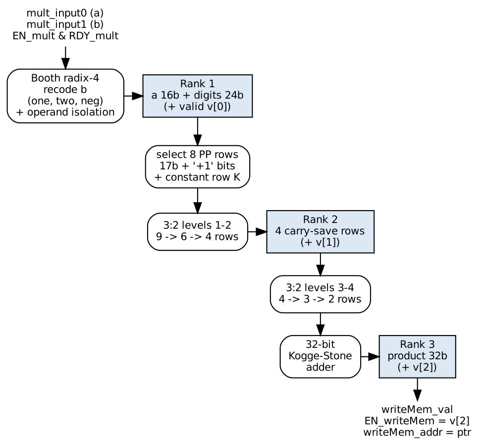
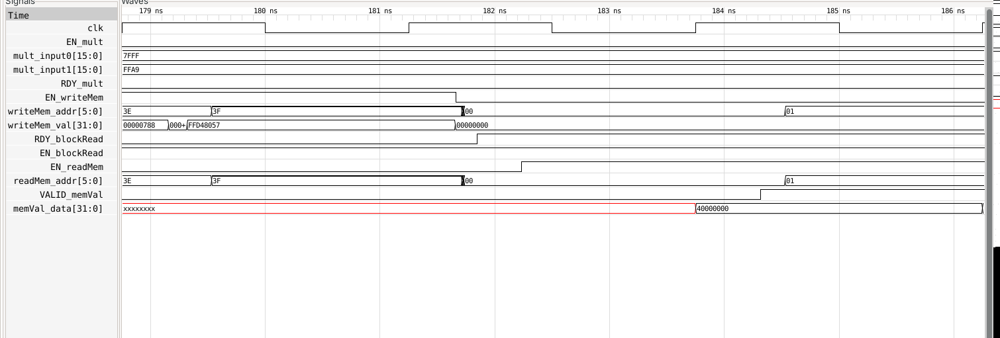

\begin{center}\fbox{\parbox{0.92\textwidth}{\textbf{AI-generated report.} This report, the RTL, the testbenches and the flow scripts were produced by an AI agent, Claude Opus 5.5 (Anthropic), working in a Claude Code session with subagents. The model is the author of record. Every number comes from a tool log under \texttt{submission/syn\_reports/} or from the sign-off scorecards, and \texttt{notes/WORKLOG.md} records the decisions in order.}}\end{center}

# Summary of results

Two implementations of `mkMultBuff` were built, one for a 2.5 ns clock and one for a 1.25 ns clock. Each takes one pair of 16-bit operands per cycle, writes the 32-bit products to an external 64-word memory in order, and returns them once the memory is full. Both meet the slack target of SPEC Section 5 in the open-source flow at the Nangate45 slow corner (0.95 V, 125 °C) and in the GPDK045 sign-off, and area and power are judged on the sign-off results.

Two rounds of flip-flop minimisation took the 800 MHz design from 577 to 422 flip-flops and the 400 MHz design from 166 to 108. In sign-off, that cut area by 25.3 % and 11.8 % and power by 28.2 % and 21.0 %.

| | 400 MHz (2.5 ns) | 800 MHz (1.25 ns) |
|---------------------------------------|------------:|------------:|
| Register ranks (latency) / flip-flops | 2 / 108 | 6 / 422 |
| GPDK045 sign-off: area | 2427.5 µm² | 4240.5 µm² |
| GPDK045 sign-off: power (vectorless) | 177.5 µW | 805.9 µW |
| GPDK045 sign-off: worst slack (target) | 158 ps (125) | 75 ps (62) |
| GPDK045 sign-off: SDF simulation | 1264 of 1264 products | 1162 of 1162 products |
| First design in sign-off: area / power | 2752.1 µm² / 224.6 µW | 5674.5 µm² / 1121.9 µW |
| Nangate45: worst setup / hold slack | +0.172 / +0.061 ns | +0.124 / +0.041 ns |
| Nangate45: cell area (sequential) | 2183.9 (488.4) µm² | 3864.2 (1910.4) µm² |
| Nangate45: power, vectorless estimate | 550.9 µW | 2113.7 µW |
| Nangate45: power from simulation, whole run | 546.8 µW | 2400.3 µW |
| Nangate45: 64-cycle fill / drain window | 1436.8 / 304.2 µW | 4424.7 / 1860.8 µW |
| RTL, gate-level and SDF checkers | ALL PASS | ALL PASS |
| Netlist that violates timing | TIMING FAIL | TIMING FAIL |
| Flip-flops proven reset by `RST_N` (F14) / RTL mutants caught | 108 of 108 / 11 of 11 | 422 of 422 / 13 of 13 |

A rerun of the whole flow from a fresh clone of the repository reproduced every netlist, SDF file and report byte for byte.

# Design decisions

## What is being minimised

The judged power is GPDK045's vectorless estimate. It assumes a default activity on every net, so it follows the number of cells and above all the number of flip-flops, each of which burns clock power every cycle. It cannot see activity savings such as operand isolation. Slack beyond the target is worth nothing. The cost is therefore flip-flops first and cells second, subject to the slack target in both flows.

When area and power moved in opposite directions, candidates were ranked by the relative change of the product area × power. For small changes this is the sum of the two relative changes.

Register to register, the two flows were about equally tight for the round 1 to 3 designs. The slack pairs (ours / sign-off) were 140/158, 96/91 and 263/203 ps. Ours is harsher on the port paths, because the input driver is modelled as a DFF_X1 and the output load is 23.5 fF, and on a one-stage 32-bit adder. In round 4, individual candidates differed by up to about 60 ps in either direction, so sign-off decided.

Sign-off power also depends on more than cell count. The row-tree candidates that lost sign-off slack, through the digit-gated reset or the combinational output path, gained 7 to 19 % power despite having fewer cells, which points to upsizing. The final Wallace design is the exception: it has the least sign-off slack and the lowest power.

Pipelining places a register on every path that crosses a cutset of the data-flow graph, so a register rank costs the width of the cutset where it is placed [18]. Minimum-register retiming [19] solves this placement formally. But retiming with initial states needs an equivalent reset state [20], and an earlier retimed candidate lost the synchronous reset of most of its registers, which F14 forbids. The cuts were therefore placed by hand from per-rank slack measured with STA (`submission/scripts/ranks.tcl`). Every candidate went through the same evaluation (`eval_candidate.sh`), and the shortlist went to sign-off.

## Control

The block passes through three states (Figure 1). When the 64th pair is accepted, F5 requires `RDY_mult` to fall at once, but F6 lets `RDY_blockRead` rise only after the last product reaches address 63. The state is held in the two registered ready flags, so they cannot glitch. A counter of accepted pairs ends FILL, the last write ends WAIT, and the accepted read of address 63 ends DRAIN. A shift register of valid bits travels with the data, and its last bit is `EN_writeMem`, which keeps `EN_writeMem` and `writeMem_addr` aligned with the product on `writeMem_val` (F4). `EN_readMem` is the AND of `EN_blockRead` and the ready flag (F7), and `memVal_data` is a wire from `readMem_val` (F8).

{width=95%}

At 400 MHz the control uses 17 flops with one pointer shared by fill and drain. At 800 MHz it uses 31. There the pointers are split into two 3-bit halves with a registered carry, the drain starts on the write made when the fill is closed and nothing else is in flight, and port-only copies of the two ready flags keep the 23.5 fF port load off the handshake logic.

## Arithmetic

Both designs use radix-4 Booth partial products [10, 13]: eight rows of 17 bits, with the sign extensions replaced by inverted sign bits and constants. Both reduce them with a bit-level Wallace tree [11] produced by `submission/scripts/gen_tree.py`. Wallace reduces as early as possible, which makes every intermediate cutset narrower than Dadda's [21] (Table 1). The tree has 13 % fewer logic gates than the row-wise 3:2 tree of the earlier designs (generic synthesis), though 35 % more XORs.

Each full adder receives its latest-arriving input on its fast input, following the timing-driven assignment of Oklobdzija, Villeger and Liu [26]. In the first two levels each adder takes the two earliest bits and the latest one. The multiplier is Booth-recoded before the first register. Recoding after it saves 8 flops, but missed the target in our flow at both frequencies.

| Tree on the Booth matrix | FA / HA | Bits after level 1 / 2 / 3 / 4 |
|---------------------------------|----------:|------------------:|
| Dadda | 91 / 22 | 132 / 104 / 84 / 60 |
| Wallace | 92 / 55 | 112 / 86 / 69 / 59 |
| Wallace, no half adders in short columns | 100 / 20 | 112 / 84 / 65 / 52 |

Two further ideas were measured and rejected. The first was resetting the 144-bit partial-product rank by gating the 24 Booth digits with `RST_N` instead of every partial-product bit. It removed about 380 generic gates, but it put a gate in front of the selection logic, and in sign-off it lowered the slack from 158 to 83 ps and raised power by 7 %. The second was clock gating (a latch plus an AND, enabled during reset to keep F14). It cut the 400 MHz drain-window power by 51 to 73 % but raised the vectorless estimate, and without a clock tree the gated clock arrived 1.4 to 2.0 ns late in SDF simulation, so every product failed.

## 400 MHz: two ranks, no product register

F4 needs `writeMem_val` only to settle within the cycle, because the output delay is 0 and the memory captures it on the rising edge. So the product register is not required. The 400 MHz design (Figure 2) has two ranks: the operand register with the Booth digits (40 bits), and the two carry-save rows at the end of the tree (51 bits, with the lowest eight columns already resolved). The final adder drives the port directly.

The other two-rank forms do not fit. With only operand and product registers, the whole multiply must fit in one stage and misses by 1.47 ns. Without an operand register, the input port's DFF_X1 driver reaching 37 gates costs 0.83 ns and the design misses by 0.31 ns.

{width=55%}

The critical path runs from rank 2 through the 32-bit adder to `writeMem_val[30]`, arriving at 2.328 ns against 2.5 ns (+0.172 ns). Its last gate, an XOR driving the 23.5 fF port, takes 0.40 ns. Dropping the product register removed 33 flops and in sign-off cut area by 8.8 % and power by 17.5 %.

## 800 MHz: six ranks, product register kept

A flip-flop's clock-to-output delay (0.35 to 0.47 ns) and setup time leave about 0.72 ns of logic per 1.25 ns stage, which is about two compression levels. The tree is therefore cut after levels 2 and 4, where Wallace leaves 85 and 52 bits. The generate and transmit bits of the final rows are formed before rank 4.

No single-stage 32-bit adder fits in one stage at this corner. The prefix networks of Harris's taxonomy [22] all missed: Han-Carlson [23] by 0.164 ns, Sklansky [24] by 0.176 ns, Kogge-Stone [12] by 0.177 ns and Brent-Kung [25] by 0.324 ns. The final adder is therefore a two-stage carry-increment adder [27]. Its middle rank holds the block sums for carry-in 0 and the block carries (38 bits). The second stage resolves the block carries and increments the blocks that receive one.

{width=70%}

At 800 MHz the product register was kept. Without it, the adder's last stage drives the port directly. Our flow needed an extra block-carry level moved into the previous stage to fit, and sign-off upsized that path: the row-tree candidate without the register lost 2.2 % area but gained 19 % power. The tree cuts were rebalanced until every rank had at least +0.124 ns in our flow. The critical path runs from a partial-product bit in rank 2 through levels 1 and 2 into rank 3, arriving at 1.037 ns against 1.161 ns.

## Candidates and the sign-off decision

Subagents evaluated the row-tree and Wallace lines in parallel. The shortlist went through sign-off, and the final choice was made on the sign-off results.

| 800 MHz candidate (sign-off) | Flops | Area (µm²) | Power (µW) | Slack (ps) | A × P |
|-------------------------------------------|----:|-------:|------:|----:|-----:|
| Row tree, product register (previous final) | 442 | 4416.2 | 829.7 | 158 | 1.000 |
| Row tree, digit-gated reset | 442 | 4429.6 | 890.7 | 83 | 1.077 |
| Row tree, no product register, digit-gated reset | 408 | 4320.8 | 988.2 | 109 | 1.165 |
| Wallace, no product register, digit-gated reset | 389 | 4188.8 | 953.1 | 99 | 1.090 |
| Wallace, product register, digit-gated reset | 422 | 4270.2 | 860.8 | 101 | 1.003 |
| **Wallace, product register, rebalanced (final)** | **422** | **4240.5** | **805.9** | **75** | **0.933** |

The final 800 MHz design is the only one that beats the previous design on both area (−4.0 %) and power (−2.9 %). At 400 MHz the Wallace design without a product register (108 flops, 2427.5 µm², 177.5 µW) replaced the version with one (141 flops, 2660.8 µm², 215.2 µW).

# Verification

**RTL checker.** A subagent wrote `rtl_checker.sv` from SPEC.md without access to the RTL. It runs a cycle-accurate reference model of the handshake, learns the latency from the first write, and checks every output on every cycle against the requirement it belongs to (F1 to F15, data, X/Z), about 54 000 checks. Inputs change 0.1 ns after the rising edge and outputs are sampled at the falling edge, so the same checker runs race-free on the RTL and on the netlist. The stimulus covers 14 fill and drain phases (about 5900 cycles) with acceptance rates from 10 to 100 %, random operands and the five directed pairs. It also drives the enables while their ready signal is 0, applies four resets including mid-drain, and runs one fill and one drain back to back for 64 cycles as power windows.

Mutation testing of the final RTL measures the checker's strength. It caught all 11 one-line faults at 400 MHz and all 13 at 800 MHz, including an early drain start, a pointer carry error and a carry-increment error in the generated adder. A SAT check on each netlist proves F14, which simulation cannot show, by showing that every flip-flop's D input is constant whenever `RST_N` = 0.

**Gate-level checkers.** `sdf_checker_400.sv` and `sdf_checker_800.sv` run six mostly back-to-back phases on the SDF-annotated netlist. They report `TIMING FAIL` for any X or wrong `memVal_data` while `VALID_memVal` is 1, and also for missing products. Without the product register at 400 MHz, `writeMem_val` settles about 2.3 ns after the edge. The memory captures it at the next edge, as it does in the checkers. Icarus Verilog applies the SDF delays but ignores `$setuphold` checks, so a violation shows up as a wrong product rather than X, as SPEC 8.2 allows. Both failure cases were demonstrated: a one-stage-multiplier netlist (−0.675 ns) at 400 MHz, and the 400 MHz netlist run at 1.25 ns (−1.047 ns) at 800 MHz. The sign-off simulator, which does evaluate timing checks, failed that last case too.

**RTL against gate-level waveforms.** The same gate-level checker was run on the RTL and on the annotated netlist and captured headlessly with GTKWave under Xvfb (Figures 4 to 6). In the RTL every output changes at the clock edge. At gate level, registered outputs change 0.45 to 0.6 ns after the edge because of the port load, which is why the checkers sample at the falling edge. `writeMem_val` also passes through short intermediate values while its bits settle, which is harmless but costs power, and it settles late in the cycle at 400 MHz, where it comes straight from the adder. `EN_readMem` follows `EN_blockRead` through one gate. `RDY_mult` is a flip-flop output and shows no glitch.

{width=100%}

{width=100%}

{width=100%}

# Area and power

Area is the sum of the Liberty cell areas of the final netlist. Flip-flops are 22 % of it at 400 MHz and 49 % at 800 MHz. The activity-based figures come from OpenSTA `read_vcd` on the zero-delay gate-level simulation of the full checker run and of its two 64-cycle windows.

| Power (µW) | 400 internal | 400 switching | 400 leakage | 400 total | 800 total |
|--------------|------:|------:|------:|------:|------:|
| Vectorless estimate | 353.0 | 165.5 | 32.4 | 550.9 | 2113.7 |
| Whole run | 349.8 | 164.7 | 32.3 | 546.8 | 2400.3 |
| Fill window | 751.4 | 650.9 | 34.5 | 1436.8 | 4424.7 |
| Drain window | 244.8 | 27.7 | 31.6 | 304.2 | 1860.8 |

In the fill window the multiplier switches every cycle. In the drain window the datapath is still, and what remains is mostly flip-flop clock power. Against the first designs, removing 155 flops at 800 MHz cut drain-window power from 2536 to 1861 µW (−27 %). At 400 MHz, removing 58 cut it from 430 to 304 µW (−29 %). The zero-delay VCD that SPEC prescribes excludes glitch power.

# Optimisation techniques and measured effect

| Technique | Measured effect (sign-off unless noted) |
|------------------------------------------------|----------------------------------------|
| Kogge-Stone map and Resizer gate sizing (flow) | one-stage multiply −5.6 → −1.9 ns (our flow) |
| Booth recoding before the first register | 400 MHz area −484 µm² (our flow) |
| Slow stacked cells, MUX2 kept out of ABC's mapping; ABC load 1 fF | 800 MHz −0.61 → +0.05 ns, −612 µm² (our flow) |
| Operand isolation | 400 MHz whole-run power 1402 → 643 µW, +49 µm² (our flow) |
| 400 MHz: one cut at the two-row cutset | −17 flops, −104 µm², −6.0 µW |
| 400 MHz: Wallace bit-level tree | −8 flops, +12.7 µm², −3.4 µW |
| 400 MHz: no product register (two ranks) | −33 flops, −233.3 µm² (−8.8 %), −37.7 µW (−17.5 %) |
| 800 MHz: 3:2 inputs ordered by arrival, two levels per stage | carry-save ranks 117 + 76 + 60 → 92 + 60 flops |
| 800 MHz: carry-increment instead of carry-select adder | middle rank 64 → 43 flops |
| 800 MHz: row tree to rebalanced Wallace tree | −20 flops, −175.7 µm² (−4.0 %), −23.8 µW (−2.9 %) |
| 800 MHz total, from the first design | 577 → 422 flops, −25.3 % area, −28.2 % power |
| Rejected: digit-gated reset, no product register at 800 MHz, clock gating | +7 %, +19 % sign-off power; vectorless +1 to +27 % |

# Tool flow and departures from the constraints

The flow uses open-source tools only and runs from `bash submission/scripts/install.sh` and `make <step> RUN=<400|800>`. The install script installs Icarus Verilog 12, GTKWave and Xvfb with apt and pulls two Docker images by digest: `openroad/orfs` for Yosys 0.68 and the OpenROAD Resizer, and `openroad/opensta` for OpenSTA 3.1.0. It also fetches the Nangate45 Liberty and Verilog cell models from a pinned commit of `mflowgen/freepdk-45nm` [2]. `gen_tree.py` regenerates both multipliers from the command lines in its docstring.

| Step | What it does |
|-----|----------------------------------------------------------------|
| `synth` | Yosys and ABC map every `.sv` file to Nangate45. The Resizer sizes and buffers the netlist, and OpenSTA reports timing, area and vectorless power and writes the SDF |
| `check` / `sim` | RTL / zero-delay gate-level simulation with the RTL checker (`sim` writes the VCD) |
| `timing` | SDF-annotated gate-level simulation with the gate-level checker |
| `power` | OpenSTA `read_vcd`, whole run and both windows |
| `timing_fail`, `f14` | failing-netlist demonstration and formal reset check |

The constraints of Section 6 are applied as written in `constraints.tcl`, with three interpretations. The input driver is DFF_X1/Q with a T/8 transition at that cell's clock input, and the clock also has a T/8 transition. The library's default wire-load model is used. The output load is four times the NAND2_X4 A1 capacitance, 23.54 fF. The remaining departures concern how the tools were used. Every reported figure is still evaluated at the target period under these constraints.

- The slowest corner available in a public source is `slow` (0.95 V, 125 °C).
- ABC maps with a Liberty copy that marks slow stacked cells and MUX2 `dont_use`, and with a 1 fF output load. The Resizer places the netlist once to enable buffering and discards the placement.
- The simulation netlist declares an unused `parameter N` for the starter harness. The SDF typical values are set to the maximum, because Icarus annotates the typical value.
- Simulated power excludes glitches, and Icarus ignores timing checks (Section 3).

# Comparison with the GPDK045 sign-off service

SIGNOFF_SECTION

# Project metrics

The work took one Claude Code session on 8 November 2026. Rounds 1 and 2 (design and report) ran from 02:33 to 07:15 UTC, round 3 from 07:50 to 09:10 UTC, and round 4 after the second review until the final build. Two or three subagents worked in parallel in each design round, with at most three flows running at a time. Token usage was counted from every session transcript under `~/.claude/projects/` by `submission/scripts/token_usage.py`. Each API response is counted once and priced at Anthropic's published API rates for Claude Opus 5.5 [17]: $4 per million input tokens, $20 per million output tokens, $0.20 per million cache reads, and 1.25 or 2 times the input rate for 5-minute or 1-hour cache writes. The count was taken just before the final build.

TOKEN_TABLE

# References

Every literature reference was checked against its bibliographic record before citing (`notes/REFERENCES_CHECK.md`).

1. ELEC 402 Project 2 specification (`SPEC.md`) and starter files, this repository.
2. C. Torng, `mflowgen/freepdk-45nm`, commit d3be42a72ca6, <https://github.com/mflowgen/freepdk-45nm>: `stdcells-wc.lib` (Nangate45 slow corner) and `stdcells.v`, from the NanGate 45 nm Open Cell Library and NCSU FreePDK45.
3. YosysHQ, Yosys 0.68, <https://github.com/YosysHQ/yosys>.
4. Berkeley Logic Synthesis and Verification Group, ABC, <https://github.com/berkeley-abc/abc>.
5. The OpenROAD Project, OpenROAD-flow-scripts, <https://github.com/The-OpenROAD-Project/OpenROAD-flow-scripts>, image `openroad/orfs` 26Q4-365-g898576f04 (BSD-3): the Resizer, Nangate45 LEF and `setRC.tcl`, and `abc_speed.script`, adapted.
6. Parallax Software, OpenSTA 3.1.0, <https://github.com/parallaxsw/OpenSTA>, image `openroad/opensta` f8e13cbf (GPL-3).
7. S. Williams, Icarus Verilog 12.0, <https://github.com/steveicarus/iverilog>.
8. GTKWave 3.3.116, <https://gtkwave.sourceforge.net>, and Graphviz, <https://graphviz.org>.
9. Cambridge Hackers, OSS CVC, <https://github.com/cambridgehackers/open-src-cvc>. Evaluated as a timing-check-aware simulator; building it was not permitted in the session.
10. O. L. MacSorley, "High-speed arithmetic in binary computers," *Proc. IRE*, vol. 49, no. 1, pp. 67–91, 1961.
11. C. S. Wallace, "A suggestion for a fast multiplier," *IEEE Trans. Electronic Computers*, vol. EC-13, no. 1, pp. 14–17, 1964. L. Dadda, "Some schemes for parallel multipliers," *Alta Frequenza*, vol. 34, pp. 349–356, 1965.
12. P. M. Kogge and H. S. Stone, "A parallel algorithm for the efficient solution of a general class of recurrence equations," *IEEE Trans. Computers*, vol. C-22, no. 8, pp. 786–793, 1973.
13. N. H. E. Weste and D. M. Harris, *CMOS VLSI Design*, 4th ed., Addison-Wesley, 2011, Ch. 11.
14. mflowgen, <https://github.com/mflowgen/mflowgen>.
15. Anthropic, Claude Code, used for this work.
16. GPDK045 sign-off scorecards, branch `check-results` of this repository.
17. Anthropic, Claude API pricing, as listed in the Claude API reference bundled with Claude Code (cached 6 October 2026), <https://www.anthropic.com/pricing>.
18. K. K. Parhi, *VLSI Digital Signal Processing Systems: Design and Implementation*, Wiley, 1999, Ch. 3, "Pipelining and Parallel Processing".
19. C. E. Leiserson and J. B. Saxe, "Retiming synchronous circuitry," *Algorithmica*, vol. 6, no. 1, pp. 5–35, 1991.
20. H. J. Touati and R. K. Brayton, "Computing the initial states of retimed circuits," *IEEE Trans. CAD*, vol. 12, no. 1, pp. 157–162, 1993.
21. W. J. Townsend, E. E. Swartzlander and J. A. Abraham, "A comparison of Dadda and Wallace multiplier delays," *Proc. SPIE*, vol. 5205, pp. 552–560, 2003.
22. D. Harris, "A taxonomy of parallel prefix networks," *Proc. 37th Asilomar Conf. Signals, Systems and Computers*, 2003, doi:10.1109/ACSSC.2003.1292373.
23. T. Han and D. A. Carlson, "Fast area-efficient VLSI adders," *Proc. 8th IEEE Symp. Computer Arithmetic*, pp. 49–56, 1987.
24. J. Sklansky, "Conditional-sum addition logic," *IRE Trans. Electronic Computers*, vol. EC-9, no. 2, pp. 226–231, 1960.
25. R. P. Brent and H. T. Kung, "A regular layout for parallel adders," *IEEE Trans. Computers*, vol. C-31, no. 3, pp. 260–264, 1982.
26. V. G. Oklobdzija, D. Villeger and S. S. Liu, "A method for speed optimized partial product reduction and generation of fast parallel multipliers using an algorithmic approach," *IEEE Trans. Computers*, vol. 45, no. 3, pp. 294–306, 1996.
27. R. Zimmermann, *Binary Adder Architectures for Cell-Based VLSI and their Synthesis*, Ph.D. thesis, Diss. ETH No. 12480, ETH Zürich, 1997.

No complete implementation of this specification from another source was used. The RTL, checkers and scripts were written in this session.

\newpage

# Appendix: source listing

Every file of `submission/rtl_400/`, `submission/rtl_800/`, `submission/testbench/` and `submission/scripts/`, and the `Makefile`. Netlists and SDF files are in `submission/outputs/`.

```{=latex}
\begin{multicols}{2}
```

LISTING

```{=latex}
\end{multicols}
```
