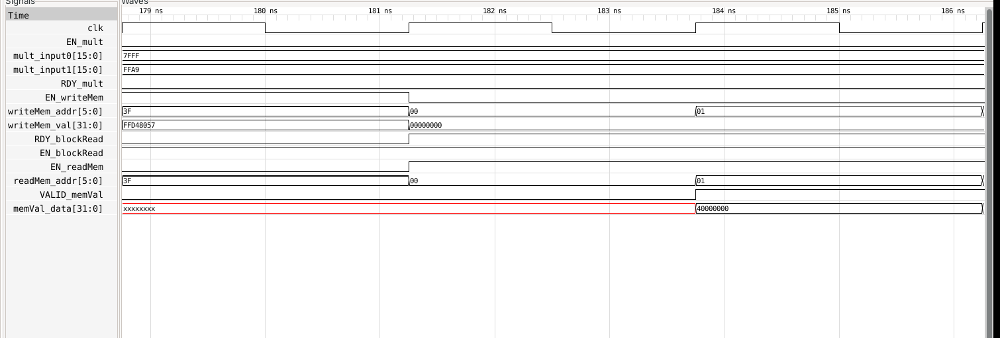
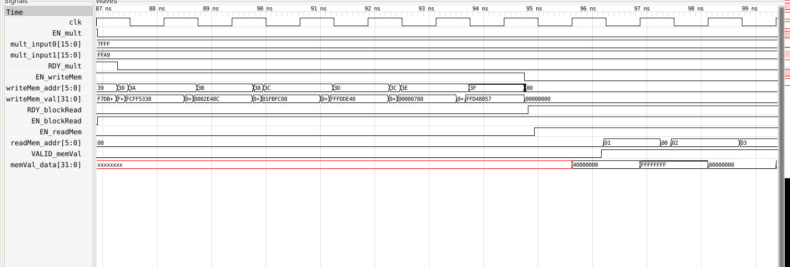

\begin{center}\fbox{\parbox{0.92\textwidth}{\textbf{AI-generated report.} This report, the RTL, the testbenches and the flow scripts were produced by an AI agent, Claude Opus 5.5 (Anthropic), working in a Claude Code session with subagents. The model is the author of record. Every number comes from a tool log under \texttt{submission/syn\_reports/}, and \texttt{notes/WORKLOG.md} records the decisions in order.}}\end{center}

# Summary of results

Two implementations of `mkMultBuff` were built, one for a 2.5 ns clock and one for a 1.25 ns clock. Each takes one pair of 16-bit operands per cycle, writes the 32-bit products to an external 64-word memory in order, and returns them to a consumer once the memory is full. Both meet the required and the target slack of SPEC Section 5 at the Nangate45 slow corner (0.95 V, 125 °C) and pass every check in the open-source flow. The independent GPDK045 sign-off service also passes both designs, with timing met, area within budget, and every product correct in its back-annotated simulation.

| | 400 MHz (2.5 ns) | 800 MHz (1.25 ns) |
|---------------------------------------|------------:|------------:|
| Register ranks (latency) / flip-flops | 3 / 166 | 7 / 577 |
| Worst setup slack, Nangate45 (target) | +0.152 ns (0.125) | +0.075 ns (0.062) |
| Worst hold slack | +0.053 ns | +0.041 ns |
| Cell area, Nangate45 (limit) | 2386.6 µm² (6000) | 4755.0 µm² (12000) |
| Power, vectorless synthesis estimate | 652.5 µW | 2727.6 µW |
| Power from simulation, whole run | 642.8 µW | 3073.1 µW |
| Power, 64-cycle fill / drain window | 1480.1 / 430.4 µW | 5209.5 / 2535.6 µW |
| RTL, gate-level and SDF checkers | ALL PASS | ALL PASS |
| Netlist that violates timing | TIMING FAIL | TIMING FAIL |
| Flip-flops proven reset by `RST_N` (F14) | 166 of 166 | 577 of 577 |
| RTL mutants caught by the RTL checker | 11 of 11 | 13 of 13 |
| GPDK045 sign-off: slack / area / power | +156 ps / 2752.1 µm² / 224.6 µW | +148 ps / 5674.5 µm² / 1121.9 µW |
| GPDK045 sign-off: SDF simulation | 1204 of 1204 products | 1249 of 1249 products |

The 800 MHz design was the smallest and lowest-power of three candidate microarchitectures evaluated in parallel. A rerun from a fresh clone of the repository reproduced every netlist, SDF file and report byte for byte.

# Design decisions

## Control: the state is the two ready flags

The difficulty of this block is the bookkeeping, not the multiplier. When the 64th pair is accepted, the last few products are still in the pipeline. F5 requires `RDY_mult` to fall at once, because pairs in flight count against the capacity. F6 allows `RDY_blockRead` to rise only after the write to address 63, a full latency later. The block must therefore pass through a third state that accepts neither operands nor reads, and the control becomes the three-state machine of Figure 1, whatever the latency.

{width=95%}

The state is held in the two registered ready flags themselves, so these outputs come straight from flip-flops and cannot glitch. A counter of accepted pairs ends FILL, a write pointer reaching 63 ends WAIT, and the accepted read of address 63 ends DRAIN, giving F10. Pointers wrap from 63 to 0, so each fill starts at address 0 without extra logic (F2). A shift register of valid bits travels with the data, and its last bit is `EN_writeMem` (F4). `EN_readMem` is the AND of `EN_blockRead` and the read-ready flag, as F7 requires. `memVal_data` is a wire from `readMem_val`, as F8 requires.

## Arithmetic: Booth radix-4, carry-save rows, prefix adders

Both designs use a radix-4 modified Booth multiplier [10, 13]. Recoding the multiplier operand into eight digits in {−2…2} halves the partial products from sixteen to eight. The sign extension of each row is replaced by an inverted sign bit and one constant (0xAAAB0000), and the +1 of each negated row goes into a free bit of the next row. Four 3:2 carry-save levels [11] reduce the nine rows to two, and a parallel-prefix adder [12] finishes the sum. Booth was chosen over a plain AND array because the array needs about twice as many full adders and two more compression levels, and area is a scoring criterion. Every pipeline cut is a parameter of `mult_pipe.sv`, which made it cheap to measure many cut positions.

Two further choices apply to both designs. First, the multiplier operand is Booth-recoded before the first register, which takes the recoder and its fan-out out of the multiply stage. At 400 MHz this alone cut the area from 2871 to 2387 µm² at the same latency. Second, the first register loads zeros whenever no pair is accepted. This operand isolation reuses the gate that the synchronous reset already needs, costs 49 µm², and halves the whole-run power (Section 5).

## 400 MHz: three ranks, latency 3

At this corner a complete 16 × 16 multiply needs about 4.4 ns of logic even after gate sizing, so it cannot fit in one 2.5 ns stage, and the minimum latency of 2 is out of reach. Three register ranks split it in two (Figure 2). Rank 1 holds the operand and the Booth digits. Rank 2 holds four carry-save rows after two compression levels. Rank 3 holds the product after the last two levels and a 32-bit Kogge-Stone adder. A sweep of cut positions showed that only the cut after level 2 meets the 125 ps target.

{width=55%}

The critical path starts at a multiplicand bit of rank 1 (fan-out 16, clock to Q 0.66 ns). It runs through the Booth select gate, the negation XNOR, two compression levels and the reset gate into rank 2, arriving at 2.300 ns against 2.452 ns required, for a slack of +0.152 ns.

## 800 MHz: seven ranks, and what it took

At 1.25 ns a flip-flop's clock-to-output delay (0.35 to 0.46 ns) and setup time (0.06 ns) leave about 0.75 ns of logic per stage, roughly two XOR delays. The design therefore has seven ranks (Figure 3). They hold the operands and digits, the selected partial products, the six rows after level 1, the three rows after levels 2 and 3, the generate and propagate bits of the last two rows, the block sums of a two-stage carry-select adder, and the product.

{width=72%}

The first attempt at 1.25 ns failed by 1.1 ns. The table lists the changes in the order they were made, each found from the worst path that OpenSTA reported.

| Change and reason | WNS (ns) | Area (µm²) |
|----------------------------------------------------------------------|------:|------:|
| Starting point: carry-save registers after levels 2 and 4, two 16-bit adder halves | −1.136 | 3655 |
| Buffer tree on `RST_N`, which drives several hundred reset gates from one modelled DFF_X1 | −0.729 | 4182 |
| Register after partial-product selection and after every level, two-stage carry-select adder | −0.610 | 5413 |
| Slow stacked cells (NOR3/4, OAI33, AOI211/221…) excluded from ABC's mapping | −0.440 | 5573 |
| Carry-select blocks as one explicit prefix (Yosys had chained two adders for `x+y+1`) | −0.159 | 5853 |
| Separate write and read pointers, port-only copies of ready flags, addresses and `EN_writeMem` | −0.014 | 5786 |
| Block carries by prefix instead of ripple, MUX2 also excluded from mapping | +0.051 | 5893 |
| Generate/propagate of the last two rows moved before rank 5 | +0.136 | 5824 |
| ABC given the real 1 fF flip-flop load instead of the 23.5 fF port load on its outputs | +0.150 | 5211 |
| Final: levels 2 and 3 merged into one stage, saving a 96-bit rank | +0.075 | 4755 |

Two of these changes concern output load. SPEC loads every output with 23.5 fF, and a flip-flop driving that load needs 0.57 to 0.66 ns from the clock instead of 0.35 ns. When the same flip-flop also feeds the next-state logic, that slow edge starts an internal critical path. Each such register therefore has a second, port-only copy. Synthesis merges registers with identical inputs and ignored a `keep` attribute, so the port copies are stored inverted and inverted again at the port. The last two rows show a deliberate trade. The slack gained by correcting ABC's load model was spent on removing a register rank, which cut 456 µm² and 0.34 mW while keeping the 62 ps target.

The final critical path starts at a level-1 carry-save register (clock to Q 0.41 ns). It runs through levels 2 and 3 and two carry gates, arriving at 1.113 ns against 1.187 ns, for +0.075 ns. The other stages finish within about 0.1 ns of it.

Three candidates were evaluated in parallel by subagents under the same flow:

| Candidate | Latency | Flops | WNS (ns) | Area (µm²) | Power run / fill / drain (µW) |
|----------------------------------|---:|----:|---------:|------:|----------------:|
| (A) Booth, carry-save, hand cut (chosen) | 7 | 577 | +0.075 | 4755 | 3073 / 5210 / 2536 |
| (B) Behavioural `*` + ABC retiming | 8 | ≈600 | −0.202 | 5819 | 3520 / 6824 / 2660 |
| (C) Baugh-Wooley [14] + generated Dadda tree [11] | 8 | 616 | +0.150 | 5278 | 3279 / 5725 / 2702 |

(B) misses timing because ABC retimes with unit delays. It also breaks F14, because retimed registers lose their synchronous reset (319 of 432 in one run). (A) and (C) both meet the target. (C) has twice the slack, but (A) is 10 % smaller and uses 6 to 9 % less power, and SPEC ranks area and power once timing is met, so (A) was kept.

# Verification

**RTL checker.** A subagent wrote `rtl_checker.sv` from SPEC.md without access to the RTL, so that it would not inherit the RTL's reading of the specification. It runs a cycle-accurate reference model of the handshake, learns the latency from the first write, and checks every output on every cycle against the requirement it belongs to (F1 to F15, data, X/Z), about 54 000 checks in all. Inputs change 0.1 ns after the rising edge and outputs are sampled at the falling edge, so the same checker runs race-free on the RTL and on the zero-delay netlist.

The stimulus covers 14 fill and drain phases (about 5900 cycles) with acceptance rates from 10 to 100 %. It uses random operands plus the five directed pairs of Section 8.1, and drives `EN_mult` and `EN_blockRead` while their ready signal is 0 to show they have no effect. Reset is applied four times, including with the pipeline full and in the middle of a drain. One fill and one drain run back to back for 64 cycles as the power windows. Mutation testing of the real RTL measures the checker's strength. One-line faults such as dropping `RDY_mult` one pair early, not resetting the valid pipeline, or a carry-in error in the adder were all caught, 11 of 11 at 400 MHz and 13 of 13 at 800 MHz. A SAT check on each netlist proves F14, which simulation cannot show, by showing that every flip-flop's D input is constant whenever `RST_N` = 0.

**Gate-level checkers.** `sdf_checker_400.sv` and `sdf_checker_800.sv` run six mostly back-to-back phases on the SDF-annotated netlist. They report `TIMING FAIL` for any X or wrong `memVal_data` while `VALID_memVal` is 1, and also for missing products. Icarus Verilog applies the SDF delays but ignores `$setuphold` checks, so a setup violation produces a stale captured value rather than X. The checkers catch it as a wrong product, as SPEC 8.2 allows. The weakness is that a violation which happens to capture the right value goes unseen. Both failure cases were demonstrated. A one-stage-multiplier netlist (slack −1.469 ns) gave 172 wrong products at 400 MHz, for example `87fc0013` where `00000013` was expected. The 400 MHz netlist run at 1.25 ns (slack −1.091 ns) fails in its control path, so the drain never starts and no product returns. The GPDK045 service ran the same experiment with a simulator that does evaluate timing checks, and it also failed, with 4058 timing-check messages and 0 products.

**RTL against gate-level waveforms.** The same gate-level checker was run on the RTL and on the annotated netlist, and the waves were captured headlessly with GTKWave under Xvfb (Figures 4 to 6). In the RTL every output changes exactly at the clock edge. At gate level three effects appear. First, registered outputs change 0.45 to 0.6 ns after the edge because of the 23.5 fF port load, which is why the checkers sample at the falling edge. Second, `writeMem_val` passes through a short intermediate value ("000+") while bits with different delays settle. The memory stores it only at the next edge, so it is harmless, but it costs power. Third, `EN_readMem` follows `EN_blockRead` through one gate. `RDY_mult` is a flip-flop output and shows no glitch, unlike designs that decode it from a counter. At 800 MHz the clock-to-output delays take about half of each cycle. Further captures (start of fill, end of drain) are in `submission/pdf_report/fig/`.

{width=100%}

{width=100%}

{width=100%}

# Area and power

Area is the sum of Liberty cell areas in the final netlist. Flip-flops are 32 % of it at 400 MHz and 55 % at 800 MHz. The vectorless estimate assumes an input activity of 0.1 per cycle. The activity-based figures come from OpenSTA `read_vcd` on the zero-delay gate-level simulation of the full checker run and of its two 64-cycle windows.

| Power (µW) | 400 internal | 400 switching | 400 leakage | 400 total | 800 total |
|--------------|------:|------:|------:|------:|------:|
| Vectorless estimate | 459.7 | 160.4 | 32.5 | 652.5 | 2727.6 |
| Whole run | 455.0 | 155.3 | 32.6 | 642.8 | 3073.1 |
| Fill window | 815.8 | 629.8 | 34.5 | 1480.1 | 5209.5 |
| Drain window | 372.6 | 25.8 | 32.0 | 430.4 | 2535.6 |

The windows show where the power goes. In the fill window the multiplier switches every cycle and switching power equals internal power. In the drain window the isolated datapath is still, and what remains is the internal clock power of the flip-flops, which is paid every cycle whether or not the data change. The 800 MHz design has 3.5 times the flip-flops at twice the frequency, and its drain power is 5.9 times larger. Clock gating would remove most of the drain power, but it was not used because it adds latches and gated clocks to a design whose every register must have a synchronous reset. The zero-delay VCD that SPEC prescribes excludes glitch power, so true power is somewhat higher.

# Optimisation techniques and measured effect

Each technique was measured by changing one thing and re-running the flow. ABC results move by up to ±0.2 ns with function-neutral changes, so smaller slack differences are not significant.

| Technique | Measured effect |
|------------------------------------------------|----------------------------------------|
| Kogge-Stone map for the final adder instead of ripple | one-stage multiply path 8.0 → 6.3 ns |
| OpenROAD Resizer gate sizing (wire-load timing) | one-stage multiply slack −3.83 → −1.92 ns |
| Booth recoding before the first register | 400 MHz area 2871 → 2387 µm² |
| Throw-away placement so the Resizer can buffer `RST_N` | 800 MHz −1.24 → −0.73 ns |
| Slow stacked cells and MUX2 excluded from mapping | 800 MHz −0.61 → −0.44 ns and −0.034 → +0.051 ns |
| Explicit prefix carry-select adder | 800 MHz −0.44 → −0.16 ns |
| Port-only register copies, separate pointers | 800 MHz −0.159 → −0.014 ns |
| Correct load model for ABC's outputs | 800 MHz −612 µm² |
| Merging compression levels 2 and 3 | 800 MHz −456 µm², −0.34 mW vectorless |
| Operand isolation | 400 MHz whole-run power 1402 → 643 µW, +49 µm² |

# Tool flow and departures from the constraints

The flow uses open-source tools only and runs from `bash submission/scripts/install.sh` and `make <step> RUN=<400|800>`. The install script installs Icarus Verilog 12, GTKWave and Xvfb with apt and pulls two Docker images by digest: `openroad/orfs` for Yosys 0.68 and the OpenROAD Resizer, and `openroad/opensta` for OpenSTA 3.1.0. It also fetches the Nangate45 Liberty and Verilog cell models from a pinned commit of `mflowgen/freepdk-45nm` [2]. Versions are recorded in `syn_reports/tool_versions.txt`.

| Step | What it does |
|-----|----------------------------------------------------------------|
| `synth` | Yosys and ABC map every `.sv` file to Nangate45. The Resizer sizes and buffers the netlist, and OpenSTA reports timing, area and vectorless power and writes the SDF |
| `check` | RTL simulation with the RTL checker |
| `sim` | zero-delay gate-level simulation with the RTL checker, writing the VCD |
| `timing` | SDF-annotated gate-level simulation with the gate-level checker |
| `power` | OpenSTA `read_vcd`, whole run and both windows |
| `timing_fail`, `f14` | failing-netlist demonstration and formal reset check |

The constraints of Section 6 are applied as written in `constraints.tcl`, with three interpretations. The input driver is DFF_X1/Q with a T/8 transition at that cell's clock input, and the clock also has a T/8 transition. The library's default wire-load model is used. The output load is four times the NAND2_X4 A1 capacitance, 23.54 fF. The remaining departures concern how the tools were used. Every reported figure is still evaluated at the target period under these constraints.

- The slowest corner available in a public source is `slow` (0.95 V, 125 °C). The original Nangate release has a low-temperature corner that no public mirror carries.
- ABC maps with a Liberty copy that marks slow cells `dont_use`, and with its own 1 fF output load. The Resizer places the netlist once to enable buffering and discards the placement.
- The simulation netlist declares an unused `parameter N`, because the starter harness instantiates `mkMultBuff #(.N(N))`. The SDF typical values are set to the maximum, because Icarus annotates the typical value.
- Simulated power excludes glitches, and Icarus ignores timing checks (Section 3).

# Comparison with the GPDK045 sign-off service

SIGNOFF_SECTION

# Project metrics

The work took one Claude Code session from 02:33 to about 03:40 UTC on 8 November 2026, followed by this report revision. Three subagents worked in parallel with the main agent: one wrote the checkers and two evaluated candidates (B) and (C). Token usage was counted from every session transcript under `~/.claude/projects/` by `submission/scripts/token_usage.py`. Each API response is counted once and priced at Anthropic's published API rates for Claude Opus 5.5 [17]: $4 per million input tokens, $20 per million output tokens, $0.20 per million cache reads, and 1.25 or 2 times the input rate for 5-minute or 1-hour cache writes. The count was taken just before the final build, so the last steps are not included.

TOKEN_TABLE

# References

1. ELEC 402 Project 2 specification (`SPEC.md`) and starter files (`starter/`), this repository.
2. C. Torng, `mflowgen/freepdk-45nm`, commit d3be42a72ca6, <https://github.com/mflowgen/freepdk-45nm>. Files used: `stdcells-wc.lib` (Nangate45 slow corner) and `stdcells.v` (cell models with specify blocks). Original sources are the NanGate 45 nm Open Cell Library and NCSU FreePDK45.
3. YosysHQ, Yosys 0.68, <https://github.com/YosysHQ/yosys>, including its `choices/kogge-stone.v` adder map and SAT solver.
4. Berkeley Logic Synthesis and Verification Group, ABC, <https://github.com/berkeley-abc/abc>.
5. The OpenROAD Project, OpenROAD and OpenROAD-flow-scripts, <https://github.com/The-OpenROAD-Project/OpenROAD-flow-scripts>, Docker image `openroad/orfs` 26Q4-365-g898576f04 (BSD-3). Used: the Resizer, the Nangate45 LEF and `setRC.tcl`, and `abc_speed.script`, adapted.
6. Parallax Software, OpenSTA 3.1.0, <https://github.com/parallaxsw/OpenSTA>, Docker image `openroad/opensta` f8e13cbf (GPL-3).
7. S. Williams, Icarus Verilog 12.0, <https://github.com/steveicarus/iverilog>.
8. GTKWave 3.3.116, <https://gtkwave.sourceforge.net>, and Graphviz, <https://graphviz.org>.
9. Cambridge Hackers, OSS CVC, <https://github.com/cambridgehackers/open-src-cvc>. Evaluated as a timing-check-aware simulator, cloned but not built, because building it was not permitted in the session.
10. O. L. MacSorley, "High-speed arithmetic in binary computers," *Proc. IRE*, vol. 49, no. 1, pp. 67–91, 1961.
11. C. S. Wallace, "A suggestion for a fast multiplier," *IEEE Trans. Electronic Computers*, vol. EC-13, pp. 14–17, 1964. L. Dadda, "Some schemes for parallel multipliers," *Alta Frequenza*, vol. 34, pp. 349–356, 1965.
12. P. M. Kogge and H. S. Stone, "A parallel algorithm for the efficient solution of a general class of recurrence equations," *IEEE Trans. Computers*, vol. C-22, pp. 786–793, 1973.
13. N. H. E. Weste and D. M. Harris, *CMOS VLSI Design*, 4th ed., Addison-Wesley, 2011, Ch. 11.
14. C. R. Baugh and B. A. Wooley, "A two's complement parallel array multiplication algorithm," *IEEE Trans. Computers*, vol. C-22, pp. 1045–1047, 1973.
15. mflowgen, <https://github.com/mflowgen/mflowgen>.
16. GPDK045 sign-off scorecards, branch `check-results` of this repository, `results/check_400-60ed005585/` and `results/check_800-b6917e9eb1/`.
17. Anthropic, Claude API pricing, as listed in the Claude API reference bundled with Claude Code (cached 6 October 2026), <https://www.anthropic.com/pricing>.

No complete implementation of this specification from another source was used. The RTL, checkers and scripts were written in this session.

\newpage

# Appendix: source listing

Every file of `submission/rtl_400/`, `submission/rtl_800/`, `submission/testbench/` and `submission/scripts/`, and the `Makefile`. Netlists and SDF files are in `submission/outputs/`.

LISTING
